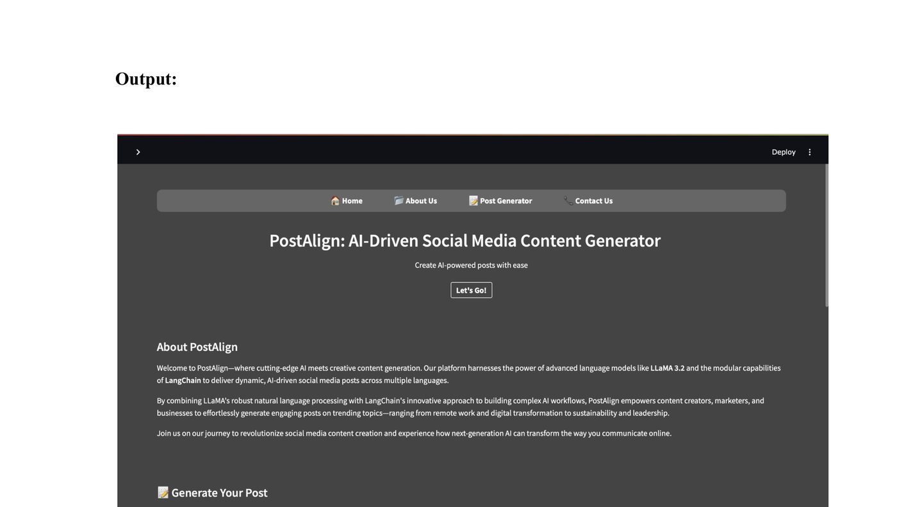
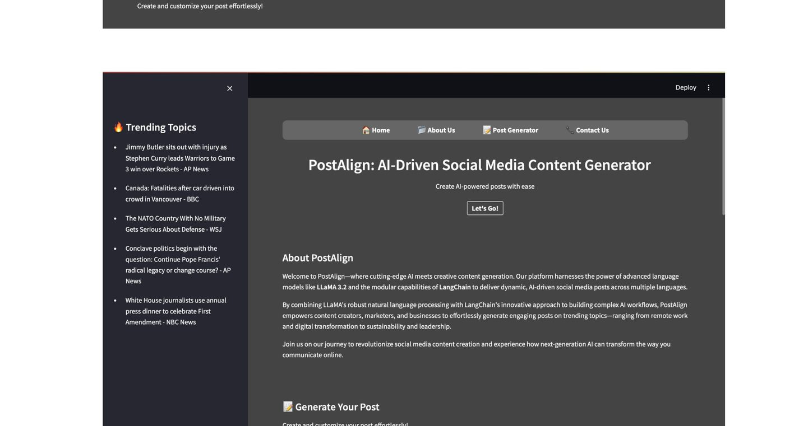

# PostAlign - AI-Driven Social Media Content Generator

## Introduction

PostAlign is an AI-driven social media content generation application designed to help users create engaging, customized posts with minimal effort. The application uses Large Language Models (LLMs) to generate content based on user-selected topics, post length, language, and tone.

Built using Streamlit, PostAlign provides an interactive interface where users can choose trending topics, enter custom topics, or select from predefined content tags to generate personalized social media posts.

## Overview

The application is organized into separate Python modules. `main.py` provides the Streamlit interface and collects user preferences, while `post_generator.py` handles prompt construction and AI-powered content generation.

The `FewShotPosts` component retrieves relevant examples from preprocessed post data. These examples are filtered according to the selected topic, language, length, and tone, and are incorporated into prompts to guide the generated content.

The preprocessing module enriches raw post data with metadata such as language, tags, tone, and post length. LangChain is used to structure the language-model workflow, while Groq provides access to the configured Llama model. NewsAPI is integrated to retrieve trending topics for content generation.

## Website Preview

### Homepage



### Homepage with Trending Topics Sidebar



## Main Functionality

- Select trending topics retrieved through NewsAPI.
- Enter custom topics manually or select from predefined tags.
- Generate short, medium, and long social media posts.
- Customize generated content using different tones, including Professional, Casual, Humorous, Inspirational, and Neutral.
- Generate content in multiple supported languages.
- Use few-shot learning with relevant example posts to guide content generation.
- View trending headlines through an interactive sidebar.

## Implementation

- **Programming Language:** Python
- **Frontend:** Streamlit
- **Language Model Integration:** Groq API, Llama 3.1 8B Instant
- **Prompt Engineering:** LangChain, Few-Shot Prompting
- **Data Processing:** Pandas, JSON
- **Trending Topics:** NewsAPI
- **Configuration Management:** Python Dotenv

## Running the Project

Install the dependencies listed in `requirements.txt` and configure the required API keys in a `.env` file.

Run the application using:

```bash
pip install -r requirements.txt
streamlit run main.py
```

The application expects preprocessed post data at `data/processed_posts.json`. The preprocessing script can be executed to generate this file from the raw post dataset, provided the required input data and API configuration are available.

## Notes

The quality and relevance of generated posts depend on the selected topic, example data, prompt configuration, and language-model responses. Generated content should be reviewed and edited before publishing.
